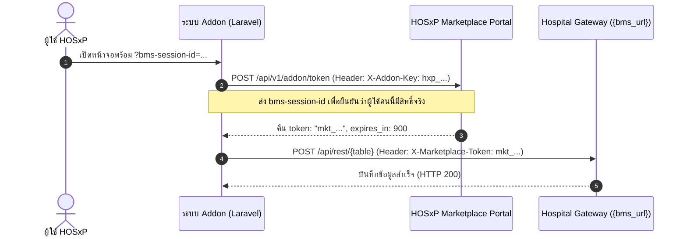

# 04. Marketplace Addon และ Token (Marketplace Guide)

> **อ้างอิงจากบทเรียน:** [04-marketplace-addon.md บน BMS Session Dev Portal](https://bms-session-dev.bmscloud.in.th/chapters/marketplace.html)  
> ครอบคลุมการลงทะเบียน Addon, วงจรชีวิตของ Token จาก `hxp_...` สู่ `mkt_...`, การควบคุมสิทธิ์เข้าถึงตาราง, และการรายงาน Telemetry

---

## 1. ขอบเขตและหน้าที่ของ HOSxP Marketplace

**HOSxP Marketplace** (`https://hosxp-marketplace.bmscloud.in.th`) เป็นศูนย์กลางสำหรับ:
1. ลงทะเบียน Addon และออก API Key ประจำตัวนักพัฒนา (`hxp_...`)
2. จัดการสิทธิ์การเข้าถึงตารางข้อมูล (Table Access Permissions)
3. ออก Access Token ชั่วคราว (`mkt_...`) สำหรับเขียนข้อมูล
4. บันทึกและเรียกเก็บค่าบริการตามการใช้งาน (Usage & Billing)
5. บริการ User Key-Value Storage บนคลาวด์

---

## 2. ขั้นตอนการเปลี่ยน `hxp_...` เป็น `mkt_...`



### คำขอออก Access Token (`POST /api/v1/addon/token`)
```http
POST https://hosxp-marketplace.bmscloud.in.th/api/v1/addon/token
X-Addon-Key: hxp_1a2b3c4d5e6f7g8h
Content-Type: application/json

{
  "bms-session-id": "A504F016-19D8-453F-B0AB-DEB5BADBB3E0"
}
```

### การตอบกลับเมื่อสำเร็จ
```json
{
  "success": true,
  "token": "mkt_987654321abcdef0123456789",
  "expires_in": 900,
  "scope": ["patient:read", "patient_note:write"],
  "hospital_code": "10989"
}
```

> [!IMPORTANT]
> **อายุของ `mkt_...` Token:**  
> Token จะมีอายุสั้นเพียง **15 นาที (900 วินาที)** เพื่อความปลอดภัยสูงสุด หากหมดอายุ Addon สามารถเรียกขอ Token ใหม่ได้ตลอดเวลาตราบใดที่ `bms-session-id` หลักยังไม่หมดอายุ

---

## 3. การตรวจสอบ Role ของผู้ใช้ (`GET /api/v1/user/profile`)

Addon สามารถตรวจสอบบทบาทและแผนกของผู้ใช้ในโรงพยาบาลได้โดยตรง:
```http
GET https://hosxp-marketplace.bmscloud.in.th/api/v1/user/profile
X-BMS-Session-Id: A504F016-19D8-453F-B0AB-DEB5BADBB3E0
X-Marketplace-Token: hxp_1a2b3c4d5e6f7g8h
```

---

## 4. การรายงานการใช้งานและการเรียกเก็บเงิน (`POST /api/v1/addon/usage`)

เมื่อ Addon มีการทำงานที่คิดค่าบริการหรือต้องการส่ง Telemetry ให้ส่งคำขอรายงานการใช้งาน:
```http
POST https://hosxp-marketplace.bmscloud.in.th/api/v1/addon/usage
X-Addon-Key: hxp_1a2b3c4d5e6f7g8h
Content-Type: application/json

{
  "bms-session-id": "A504F016-19D8-453F-B0AB-DEB5BADBB3E0",
  "event_type": "ai_transcription_minutes",
  "units": 2,
  "timestamp": "2026-10-25T21:00:00Z"
}
```
