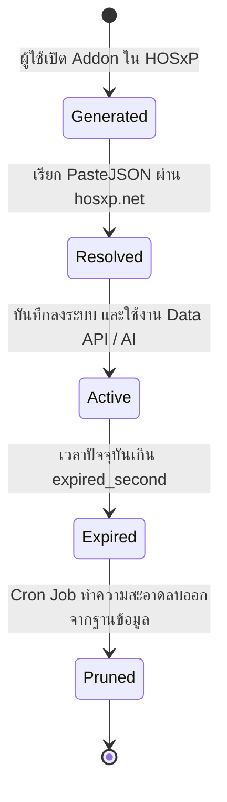

# 01. แบบจำลองความปลอดภัยและวงจรชีวิต Session (Security Model)

> **อ้างอิงจากบทเรียน:** [security-model.md บน BMS Session Dev Portal](https://bms-session-dev.bmscloud.in.th/chapters/security-model.html)  
> ครอบคลุมวงจรชีวิตของ Session, โมเดล Token ทั้ง 4 ชนิด, สถาปัตยกรรมความปลอดภัย 3 ชั้น, และ Privacy by Design

---

## 1. วงจรชีวิตของ BMS Session (Session Lifecycle)



1. **การสร้าง Session (Generation):** โปรแกรม HOSxP ติดต่อกับ mORMot Gateway หรือ BMS Cloud เพื่อสร้าง `bms-session-id` ชั่วคราว ผูกกับ Workstation และผู้ใช้ปัจจุบัน
2. **การ Resolve:** ฝั่ง Web App / Addon นำ `bms-session-id` ไป Resolve ที่ `https://hosxp.net/phps/bms_session_paste.php` เพื่อดึง `{bms_url}` และ `{bms_session_code}`
3. **การใช้งาน (Active):** Addon ใช้งานคำสั่ง SQL, REST หรือ AI Gateway ตราบใดที่ยังไม่หมดอายุ
4. **การหมดอายุและการ Prune:** เมื่ออายุของ Session ถึงเวลา `expires_at` ระบบจะไม่ยอมรับคำขอ และ Cron Job จะทำการลบ Session ที่หมดอายุทิ้งเพื่อรักษาพื้นที่ฐานข้อมูล

---

## 2. โมเดลความปลอดภัย 3 ชั้น (3-Tier Security Boundaries)

```
[ ชั้นที่ 1: ผู้ใช้ทั่วไป / ไม่ระบุตัวตน (Anonymous) ]
  • เข้าถึงได้เฉพาะหน้าสาธารณะ (Public Homepage / Static Assets)
  • ไม่สามารถยิงคำขอผ่าน Gateway หรืออ่านข้อมูลผู้ป่วยได้
                │
                ▼ (เมื่อมี bms-session-id จาก HOSxP)
[ ชั้นที่ 2: โหมดนักพัฒนา / อ่านข้อมูลอย่างเดียว (Development Read-Only) ]
  • รันคำสั่งอ่านข้อมูลผ่าน /api/sql และ GET /api/rest ได้
  • ระบบเปิด Data Masking ปกป้องข้อมูลส่วนบุคคลอัตโนมัติ
  • ปฏิเสธคำสั่งเขียนทุกชนิด (403 Forbidden)
                │
                ▼ (เมื่อแลกเปลี่ยนเป็น Marketplace Token mkt_...)
[ ชั้นที่ 3: โหมดการผลิต / สิทธิ์เต็มรูปแบบ (Production Read-Write) ]
  • ปลดล็อคสิทธิ์เขียนข้อมูล (POST, PUT, DELETE) บนตารางที่ได้รับอนุญาต
  • แสดงข้อมูลจริง (Unmasked Data) สำหรับแพทย์และบุคลากรทางการแพทย์
  • บันทึก Audit Log ลงตาราง bms_ops_usage_log ทุกครั้ง
```

---

## 3. สถาปัตยกรรม Privacy by Design

เพื่อปฏิบัติตาม พ.ร.บ. คุ้มครองข้อมูลส่วนบุคคล (PDPA) BMS Gateway จะประเมินทุกคอลัมน์ที่ส่งกลับ:
* ข้อมูลอ่อนไหวระดับบุคคล (ชื่อ-นามสกุล, ที่อยู่, เบอร์โทร, เลขบัตรประชาชน) จะถูกแทนที่ด้วย `[MASKED]` เสมอในโหมดทดสอบ
* ไม่มีการส่งรหัสผ่านผู้ใช้งาน หรือข้อมูลการเข้ารหัสระบบออกสู่ภายนอก
* คำสั่ง SQL ถูกควบคุมผ่าน Parser อัตโนมัติ ป้องกันการ Injection และปฏิเสธตาราง Blacklist ในระดับ Gateway
