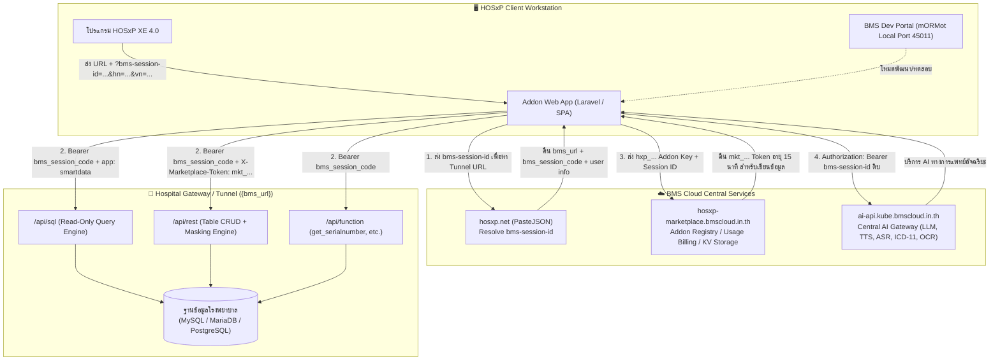

# คู่มือนักพัฒนา BMS Session API (HOSxP Ecosystem)
> **Official Developer Guide & Architecture Specification**  
> เอกสารฉบับสมบูรณ์สำหรับการเชื่อมต่อ HOSxP, BMS Session API, HOSxP Marketplace, Cloud KV Storage และ BMS Cloud AI Services  
> อ้างอิงจากระบบจริง: [https://bms-session-dev.bmscloud.in.th/chapters/home.html](https://bms-session-dev.bmscloud.in.th/chapters/home.html)

---

## 🗺️ แผนผังสถาปัตยกรรมทั้งระบบ (System Architecture)

---

## 📌 สารบัญหลัก (Table of Contents)

### 01. เริ่มต้นใช้งาน (Getting Started)
* [**01. ภาพรวมระบบและ Token 4 ชนิด**](./01-getting-started/01-overview.md)
  - BMS Session คืออะไร และสถาปัตยกรรมร่วมกับ HOSxP
  - Token ทั้ง 4 ชนิด (`bms-session-id`, `bms_session_code`, `hxp_...`, `mkt_...`)
  - การเตรียม Environment ทดสอบด้วย BMS Dev Portal (mORMot Port 45011)
* [**02. บทเรียน 15 นาที: Query แรกสู่ HOSxP**](./01-getting-started/02-first-query.md)
  - จาก URL parameter สู่การ Resolve ผ่าน PasteJSON
  - การส่ง Query แรกผ่าน `/api/sql` ด้วย Header `Authorization: Bearer`
* [**03. โหมด Development กับ Production**](./01-getting-started/03-dev-vs-production.md)
  - กฎ Read-Only และระบบปกปิดข้อมูลอัตโนมัติ (Data Masking)
  - การปลดล็อคสิทธิ์เขียนข้อมูล (Write) ด้วย Marketplace Token

---

### 02. คู่มือการใช้งาน (Guides)
* [**01. SQL Query ผ่าน `/api/sql`**](./02-guides/01-sql-queries.md)
  - ครบทั้ง 4 ฟิลด์ของ Request (`sql`, `app`, `params`, `marketplace-token`)
  - Parameter Binding Named Placeholder (`:param_name`) และ `value_type` ทั้ง 7 แบบ
  - ความแตกต่างระหว่าง MySQL, MariaDB และ PostgreSQL
  - ตาราง Blacklist (ห้ามเข้าถึง เช่น `opduser`) และการใช้ `LIMIT`
* [**02. REST CRUD ผ่าน `/api/rest`**](./02-guides/02-rest-crud.md)
  - ตัวดำเนินการ Filter ทั้ง 9 แบบ (`eq`, `ne`, `gt`, `gte`, `lt`, `lte`, `like`, `in`, `is_null`)
  - การ Join / Expand ตารางสัมพันธ์
  - การเขียนข้อมูล (POST, PUT, DELETE) และ Header `X-Marketplace-Token`
  - ตาราง Audit Log `bms_ops_usage_log`
* [**03. Server Functions ผ่าน `/api/function`**](./02-guides/03-functions.md)
  - `get_serialnumber`: การสร้าง Primary Key สำหรับตาราง HOSxP ที่ไม่มี AUTO_INCREMENT
  - `get_hosvariable` และ `set_hosvariable`: จัดการค่าระบบจาก `sys_var`
  - `get_cds_xml`: ดึง Clinical Data Set
* [**04. Marketplace Addon และ Token**](./02-guides/04-marketplace-addon.md)
  - วงจรชีวิตของ `hxp_...` สู่ `mkt_...` (อายุ 900 วินาที)
  - การขอสิทธิ์และตรวจสอบสถานะ Token
  - การส่งบันทึก Telemetry และ Issue Reporting
* [**05. User Data Storage (Cloud KV Store)**](./02-guides/05-user-storage.md)
  - Cloud Key-Value Store ส่วนตัวแยกตาม User และ Hospital
  - CRUD Endpoint, Versioning ป้องกันเขียนทับ (Optimistic Lock) และ Quota (5MB)
* [**06. บริการ AI ของ BMS Cloud (`ai-api.kube.bmscloud.in.th`)**](./02-guides/06-ai-services.md)
  - LLM Chat Completions (มาตรฐาน OpenAI `/v1/chat/completions`)
  - Thai Audio Normalization (`/v1/audio/normalize` สำหรับคำอ่านการแพทย์)
  - Thai TTS (`/v1/audio/speech`) และ Thai ASR (`/v1/audio/transcriptions`)
  - ICD-11 Semantic Lookup (`/v1/icd11/lookup` ค้นหารหัสโรคพร้อม ICD-10 mapping)
  - Medical Document OCR (`/v1/ocr/extract`)
* [**07. เครดิตและการเรียกเก็บเงิน (Billing & Usage Reporting)**](./02-guides/07-billing.md)
  - การหักหน่วยเครดิตและการส่งรายงาน `POST /api/v1/addon/usage`
* [**08. การฝัง Addon ในหน้าจอ HOSxP**](./02-guides/08-hosxp-integration.md)
  - รูปแบบ URL ที่ HOSxP สร้างจริง และตัวพิมพ์เล็ก `hn` / `vn`
  - กับดักสำคัญ: เลข 0 นำหน้าของ HN/VN ต้องคงเป็น String เสมอ
* [**09. ไคลเอนต์และไลบรารีพัฒนา (`bms-session-client`)**](./02-guides/09-client-library.md)
  - โครงสร้างและแนวทางการเขียน Client Wrapper ทั้งใน JavaScript และ PHP

---

### 03. เอกสารอ้างอิง (Reference)
* [**01. Endpoint อ้างอิงทั้งหมด**](./03-reference/01-endpoints.md)
  - สรุปทุก URL, HTTP Method, Headers, Request Body และ Response Envelope
* [**02. ชนิดข้อมูล, รหัสข้อผิดพลาด และข้อจำกัด**](./03-reference/02-data-types.md)
  - Field Type Codes (2=int, 6=string, 10=date/datetime ฯลฯ)
  - MessageCode 200, 400, 401, 403, 404, 409, 500
  - ตาราง Blacklist และขีดจำกัดความปลอดภัย
* [**03. พจนานุกรมตาราง HOSxP ที่ใช้บ่อย**](./03-reference/03-hosxp-tables.md)
  - โครงสร้างและ Primary Key ของ `patient`, `ovst`, `opdscreen`, `ipt`, `opitemrece`, `ovstdiag`, `officer`, ฯลฯ

---

### 04. สถาปัตยกรรม (Architecture)
* [**01. แบบจำลองความปลอดภัยและวงจรชีวิต Session**](./04-architecture/01-security-model.md)
  - Session Lifecycle & Expiration Model (`expired_second`)
  - โมเดลสิทธิ์ 3 ชั้น (Anonymous -> Dev Read-Only -> Production Write)
  - Privacy by Design & Automated Data Masking

---

### 05. ตัวอย่างการพัฒนาใน Laravel
* [**01. สถาปัตยกรรม Service Layer ใน Laravel (SmartData)**](./05-laravel-implementation/01-laravel-service-architecture.md)
  - การใช้งาน `BmsSessionService`, `BmsDataService`, `BmsAiService`, `BmsMarketplaceService`
  - Facade Gateway `Bms::session()`, `Bms::data()`, `Bms::ai()`, `Bms::isAdmin()`
  - การตรวจสอบสิทธิ์ Admin กลุ่ม 19 ผ่าน `/api/sql`
  - ตารางเก็บ Session และระบบ Prune อัตโนมัติ

---

## 🔑 สรุป Token ทั้ง 4 ชนิดในระบบ

| Token / Credential | รูปแบบ / Prefix | ได้รับจากที่ไหน | นำไปส่งที่ไหน | วัตถุประสงค์ / สิทธิ์ |
| :--- | :--- | :--- | :--- | :--- |
| **1. `bms-session-id`** | UUID / String | HOSxP ส่งมาทาง Query String เมื่อเปิด Addon | • `hosxp.net/phps/bms_session_paste.php` • `ai-api.kube.bmscloud.in.th` | • Resolve หา Tunnel URL ของ รพ. • ใช้เป็น Bearer Token ยิง BMS AI Gateway โดยตรง |
| **2. `bms_session_code`** | Opaque Token | ได้จาก JSON เมื่อ Resolve `bms-session-id` ผ่าน PasteJSON | • `{bms_url}/api/sql` • `{bms_url}/api/rest` • `{bms_url}/api/function` | • Bearer Token ประจำตัวสำหรับเรียก Data API ของ รพ. • ห้าม parse โครงสร้างภายใน |
| **3. `hxp_...`** | `hxp_` + Hex/String | ลงทะเบียน Addon ใน HOSxP Marketplace Portal | • `hosxp-marketplace.bmscloud.in.th` | • ยืนยันสิทธิ์นักพัฒนาประจำ Addon • ใช้ขอ `mkt_...` Token และส่งรายงาน Billing |
| **4. `mkt_...`** | `mkt_` + Hex/String | ขอจาก Marketplace API (`POST /api/v1/addon/token`) | • `{bms_url}/api/rest` (Header `X-Marketplace-Token`) | • **ปลดล็อคสิทธิ์เขียนข้อมูล (Write Access)** • ปลด Mask ข้อมูลอ่อนไหว (Sensitive Data) |
